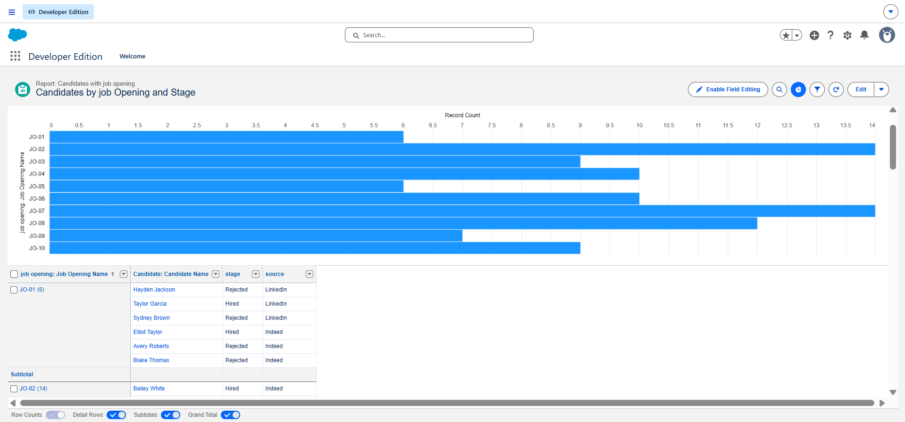
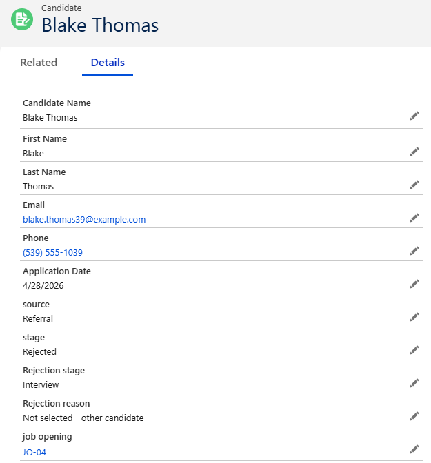
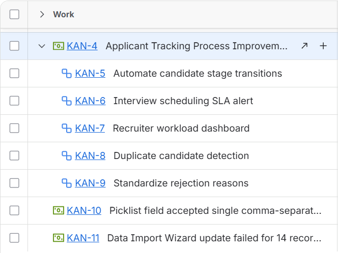

# Recruiting Applicant Tracking System: Salesforce, Jira and Excel

A practice project that models how a recruiting team could track candidates in one system instead of spreadsheets and email. I built the data model in a Salesforce Developer Edition org, loaded candidate data, managed the work and issues in Jira, and analyzed the hiring funnel in Excel.

**Important:** all data in this project is synthetic. I generated 97 candidates and 10 job openings for practice. Any numbers below describe this sample data, not a real company.

## The business problem

Recruiters track applicants in spreadsheets and email threads. There is no single place that shows each candidate's stage, who owns them, or why they were rejected. That makes it hard to see where candidates stall, to report on rejection reasons, or to compare recruiter workload.

## The process I modeled

Application, Recruiter Review, Screening, Interview, Offer, Background Check, then Hired. A candidate can be Rejected at any stage, and a rejection needs a reason.

## What I built

**Salesforce (Developer Edition)**
- 4 custom objects: Job_Opening__c, Candidate__c, Interview__c and Offer__c, with fields, picklists and relationships between them.
- Loaded 97 candidate records and 10 job openings with the Data Import Wizard.
- Used a unique Email field and an External ID so records match correctly on import.
- A report grouped by job opening, with each candidate's stage shown.

**Jira (free Cloud site)**
- One epic with subtasks to plan the work.
- Logged issues found during the build as tickets. One example is the duplicate name problem during import (KAN 11).

**Excel**
- A workbook with 4 sheets: Candidates, Job Openings, Metrics Dashboard and Stage Duration Analysis.
- Metrics are calculated with live formulas (SUMPRODUCT, COUNTIFS, AVERAGEIFS), so changing the data updates every number.

## Screenshots

**Salesforce report: candidates grouped by job opening, with stage shown**

**A candidate record, linked to a job opening, with stage and rejection details**

**Jira epic with subtasks, plus issues logged during the build**

## Data model

| Object | Purpose | Key fields |
|---|---|---|
| Job_Opening__c | An open position | Title, Department, Status, Target Hires, Open Date |
| Candidate__c | A person applying | Name, Email, Source, Stage, Application Date, Rejection Stage, Rejection Reason |
| Interview__c | An interview for a candidate | Interviewer, Scheduled Date and Time, Status, Recommendation |
| Offer__c | An offer for a candidate | Offer Date, Response Date, Salary, Status |

Candidates link to a job opening. Interviews and offers belong to a candidate.

## Design ideas for automation

These were designed and written up, not all fully implemented:
- A flow that stamps the date whenever a candidate's stage changes.
- A validation rule that requires a rejection reason when a candidate is rejected.
- A duplicate rule that matches candidates on email.
- A scheduled alert for candidates who wait in Screening more than 5 business days with no interview.

## What the sample data showed

In the sample data, about half of the candidates who reached the interview stage waited 10 or more days between Screening and Interview scheduling, averaging 9.1 days against 3 to 6 days for every other step. Because I generated the data myself, this is an illustration of the analysis method, not a real finding. In a real project, I would check whether the same gap appears in the company's actual data before recommending a fix.

## Problems I hit and how I fixed them

- **Duplicate record errors on import.** Matching on Name caused 14 DUPLICATE_VALUE errors. I made Email a unique field, added an External ID, and matched on Email instead. The reload processed 97 records with 0 failures.
- **Duplicate records from a first attempt.** I removed them with a bulk delete in Workbench, then reloaded cleanly.
- **A picklist field that kept only one value.** I fixed the picklist setup so each field held its full set of values.

## Files in this repository

| File | What it is |
|---|---|
| Candidates_Import.csv | The 97 synthetic candidates loaded into Salesforce |
| Job_Openings_Import.csv | The 10 synthetic job openings loaded into Salesforce |
| ATS_Recruiting_Analytics.xlsx | The Excel workbook with the funnel metrics and stage duration analysis |

## Skills used

Salesforce data modeling, data import and matching, reports, Jira issue tracking, Excel formulas and analysis, requirements and process thinking.
